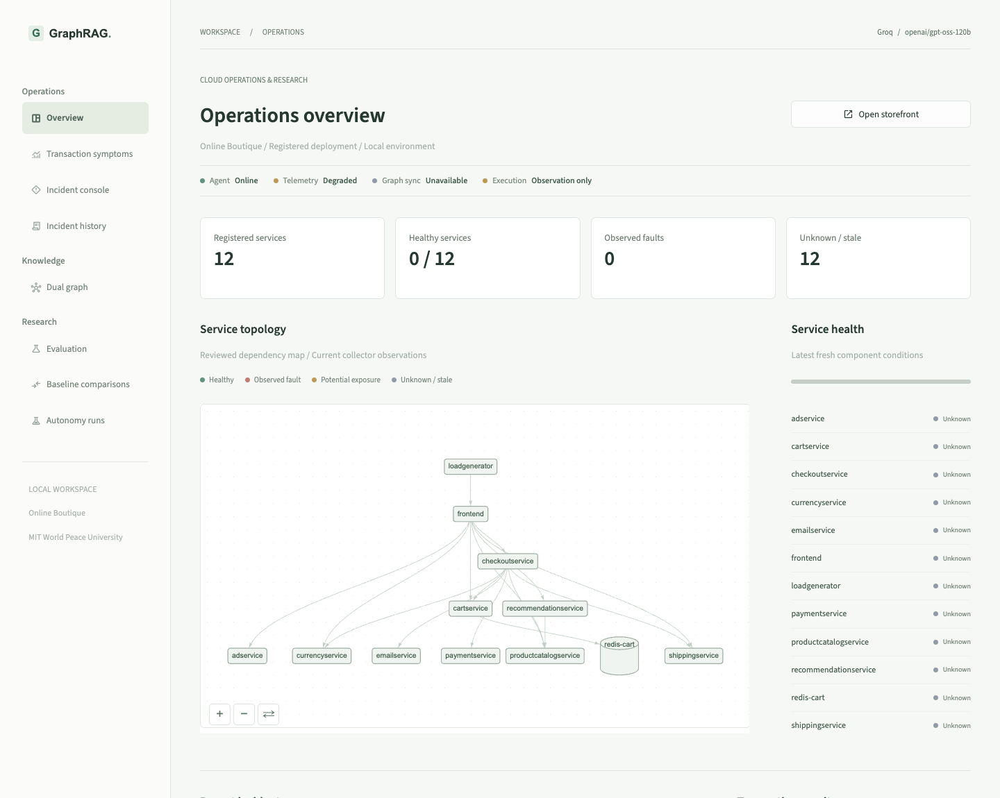
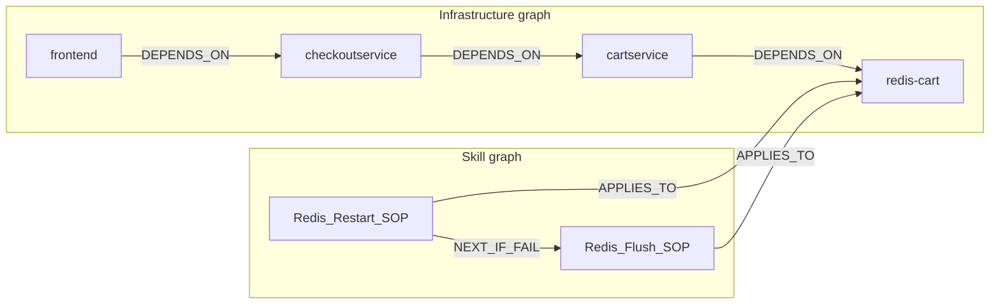
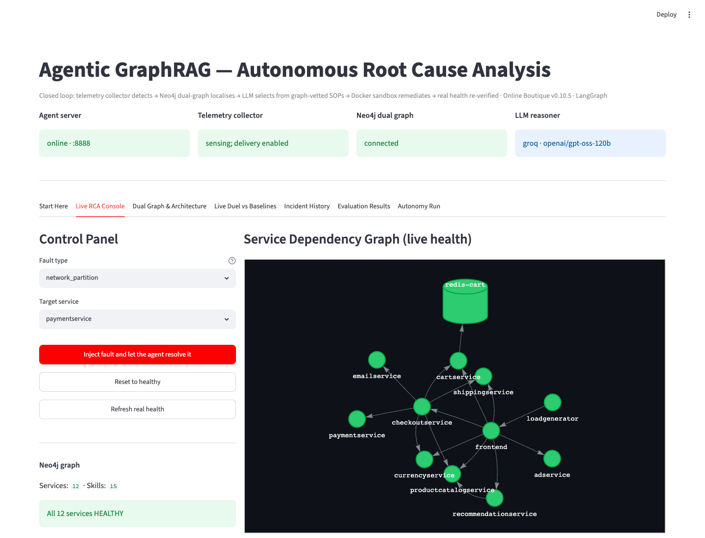
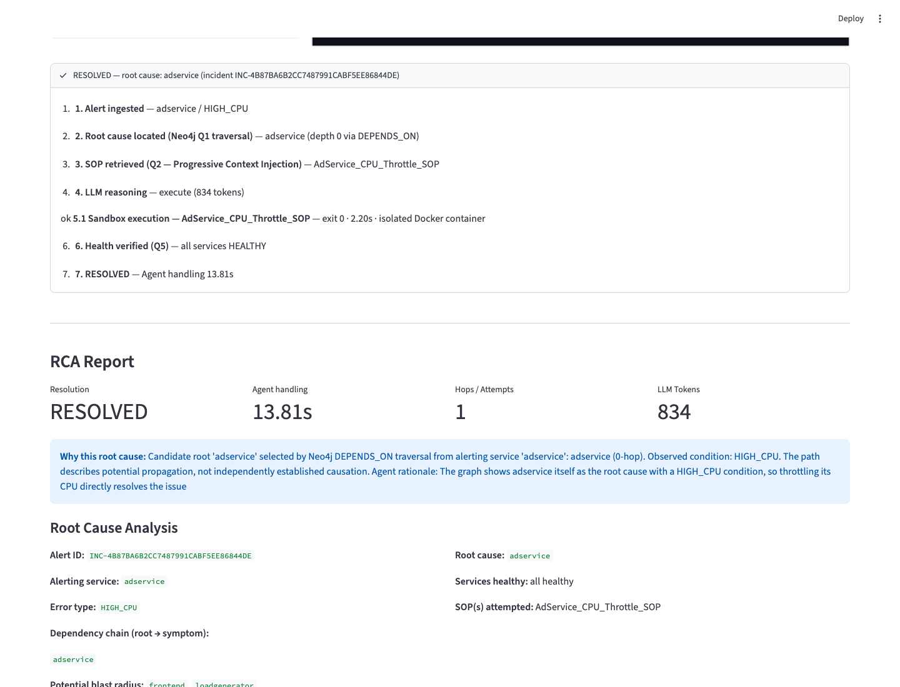
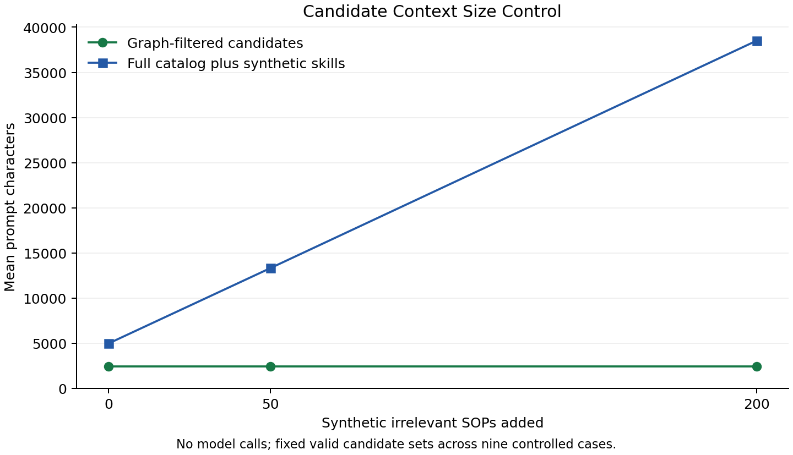
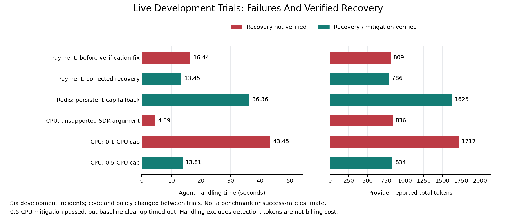

# Agentic GraphRAG for Root Cause Analysis

**Topology-aware investigation and constrained, independently verified recovery
for cloud-native microservices.**

[](https://github.com/raghavnimbalkar1/Agentic-GraphRAG-for-Root-Cause-Analysis-/actions/workflows/tests.yml)

[Architecture](docs/ARCHITECTURE.md) · [SOP Catalog](docs/SOP_CATALOG.md) ·
[Quick Start](#quick-start) · [Evidence](#evaluation-and-evidence) ·
[Research Plan](docs/JOURNAL_STUDY_PLAN.md) · [Status](docs/STATUS.md)

This AIOps research prototype observes a running microservice application,
investigates its dependency graph, asks an LLM to select an approved remediation,
executes that procedure under restricted permissions, and checks whether the
application actually recovered. It is an incident-response system, not a chatbot.



*Streamlit workspace, October 19, 2026. Infrastructure was unavailable at capture:
the reviewed topology remains visible and service observations correctly show
unknown. The capture documents the interface, not a recovery result.*

## Project At A Glance

| Component | Implemented scope |
| --- | --- |
| Target environment | Online Boutique on Docker Compose: ten application services, Redis and a load generator |
| Infrastructure graph | 12 `Service` nodes and 16 `DEPENDS_ON` relationships |
| Remediation graph | 15 `Skill` nodes, 19 `APPLIES_TO` relationships and one `NEXT_IF_FAIL` relationship |
| Procedure library | Eight curated scripts exposed as 15 target/condition-specific skills, covering 11 trigger labels |
| Sensing | Independent Docker, Redis, gRPC and HTTP observations; nominal five-second collection cadence |
| Agent | Typed LangGraph workflow, exact-name LLM selection, bounded attempts and terminal escalation |
| Execution | Restricted ephemeral SOP containers; fixed host-controller operations for approved targets |
| Verification | Fresh service checks and two successful cart/checkout rounds when frontend is affected |
| Interface | Streamlit dashboard, FastAPI incident endpoint and incident-addressed audit reports |

**Status:** the complete loop has run with real Groq inference and real simulation
repairs. This remains a research prototype. Repeated all-family acceptance,
adaptive investigation and fair comparative model evaluation are unfinished.
See [what is agentic, what is fixed, and what remains](docs/AGENTIC_SCOPE.md).

The next implementation stage has started with an opt-in
[symptom-observation profile](docs/SYMPTOM_OBSERVATION.md): a shared deployment
registry, bounded local evidence and a separate checkout monitor. Its dashboard
shows symptom episodes and service/resource windows with evidence IDs, missing
values and freshness. This profile records frontend symptoms without attributing
a root or submitting repairs. An opt-in frontend log pilot retains fixed error
categories and codes, not raw messages; live image validation is pending.
A separate [read-only investigation boundary](docs/INVESTIGATION_BOUNDARY.md)
adds fixed tools, availability cutoffs and citation checks. An optional
[shadow LangGraph](docs/SHADOW_INVESTIGATION.md) now supports bounded diagnostic
decisions, a same-tool fixed-policy baseline and sanitized frozen-input replay.
The first real Groq shadow smoke trial proposed without gathering component
evidence and was rejected. This is a retained failure, not successful diagnosis.
The new loop is not enabled in the live dashboard or remediation workflow.

## Why Two Graphs?

An alert identifies a symptom; a runbook describes an action. The architecture
connects them through two logical graphs in one Neo4j database:

- **Infrastructure graph: where to investigate.** Service dependencies support
  attribution paths and potential-impact analysis using current observations.
- **Skill graph: what may be done.** Approved procedures carry applicability,
  trigger conditions, risk labels and execution metadata. Explicit fallback
  edges describe permitted next steps after unsuccessful verification.



*A real subset of the catalog, not the full topology. An arrow from A to B means
A depends on B. Reports can display the same path root-first.*

Q1 performs deterministic dependency traversal; Q2 retrieves relevant procedure
candidates; Q3 retrieves an explicit fallback. **The LLM chooses among candidates,
not arbitrary code.** Candidate filtering is called Progressive Context Injection
in this project. It reduces irrelevant context, but does not guarantee constant
token cost as the relevant candidate set or incident history grows.

## Incident Lifecycle

```mermaid
flowchart TD
    shop[Running Online Boutique] --> telemetry[Independent telemetry]
    telemetry --> graph[Neo4j: observed service state]
    telemetry --> api[Debounced incident and API delivery]
    api --> retrieve[Q1 root attribution and Q2 candidates]
    graph --> retrieve
    retrieve --> model[LLM: select, skip or escalate]
    model --> guard[Validate exact skill, target and fresh condition]
    guard --> executor[Restricted SOP container]
    executor --> verify[Fresh service and application verification]
    verify -->|Recovered| report[RCA report and dashboard]
    verify -->|Unresolved, allowed next attempt| retrieve
    model -->|Escalate| report
    guard -->|Denied or uncertain| report
    verify -->|Partial or exhausted| report
```

1. A fault changes the actual simulation. **The injector does not send the alert
   or write the answer into Neo4j.**
2. The collector measures the environment, synchronizes observed health and
   creates an incident after repeated matching observations.
3. Graph retrieval rejects missing, stale or ambiguous evidence. It returns a
   candidate root, dependency path and applicable unvisited procedures.
4. The model supplies a structured decision. The application validates the exact
   skill name; script, target and permissions come from trusted catalog state.
5. Execution rechecks the condition, applies only the approved operation and
   records its result. Uncertain controlled operations stop further execution.
6. Independent verification decides the outcome. A successful command, ready
   container or green homepage alone does not establish checkout recovery.
7. The report preserves decisions, actual executions, verification and failure
   details under the collector's incident ID.

### A Real Payment Recovery



*Original October 13 rehearsal capture, retained with its development evidence.*

In the corrected payment-network trial, checkout succeeded before injection,
timed out while payment was disconnected, and succeeded after the agent selected
`Payment_Restart_SOP` and the controller restarted/reconnected payment. The model
call used 786 tokens; agent handling took 13.448 seconds. These are individual
development observations, not average performance or a production payment test.

The first rehearsal falsely reported recovery from component health alone.
That failed case is preserved. The corrected evaluator now requires successful
application transactions as well. Read the
[step-by-step incident and evidence](eval/results/verified/20261014/README.md).

### A Verified Mitigation Is Not A Permanent Repair



*October 14 development trial: a real Groq decision selected the 0.5-CPU cap;
readiness and checkout passed. This contains the runaway workload rather than
removing it. Baseline cleanup subsequently timed out, so the overall rehearsal
was not marked passed. The report screenshot alone must not hide that outcome.*

## Remediation Coverage

| Procedure family | Supported examples | What it cannot establish |
| --- | --- | --- |
| Restart/reconnect | Payment network partition, catalog pause/crash, service-specific transient failures | Repair of arbitrary code defects, missing containers or every crash condition |
| Redis repair | Runtime memory cap, eviction-policy drift, client-count and expiring-key anomalies | General data correctness, a proven kernel OOM kill or persistent configuration repair |
| Resource intervention | Adservice CPU cap, recommendation restart, fixed email temp-file cleanup, frontend quota restoration | Generic resource diagnosis or durable removal of every underlying cause |

The [complete SOP catalog](docs/SOP_CATALOG.md) explains **every named skill**,
its actual operation, target, trigger, side effects and limits. For example,
`Redis_Flush_SOP` deletes all Redis keys; its current LOW label belongs to a
disposable benchmark policy and must not be interpreted as production permission.

## Quick Start

**Requirements:** Python 3.11+, Docker with Compose v2, sufficient memory for
the benchmark and Neo4j, and credentials for a configured model provider.
The tested deployment runs Python locally on macOS arm64; Boutique application
images use amd64 emulation and the executor is built natively. This is not a
validated Kubernetes or fully containerized agent deployment.

### 1. Configure The Environment

```bash
bash scripts/setup_dev_env.sh
source .venv/bin/activate
```

The setup script creates `.env` from its template only when absent. Configure
`NEO4J_PASSWORD`, `DOCKER_HOST`, `LLM_PROVIDER`, `LLM_MODEL` and the appropriate
provider key. Never commit `.env`. The template uses Groq-hosted
`openai/gpt-oss-120b`; that model prefix does not require an OpenAI key.
Other adapters exist, but adapter support is not evidence of live validation.

See [environment configuration](docs/OPERATIONS.md#environment) for Docker
endpoint selection, model settings and platform limitations.

### 2. Start The Infrastructure

```bash
docker compose up -d --wait --wait-timeout 180 neo4j
python -m graph.scripts.init_graph
docker build -t sop-executor:latest sop-executor/
docker compose -f simulation/docker-compose.yml pull
docker compose -f simulation/docker-compose.yml up -d --wait --wait-timeout 300
```

Keep existing Neo4j volumes. Initialization uses the maintained catalog; do not
replace it with the older illustrative roadmap schema.

### 3. Start The Application Processes

Run each process in a separate terminal from the repository root:

```bash
python -m agent.main
```

```bash
python -m simulation.telemetry_collector --observe-only
```

```bash
streamlit run dashboard/app.py --server.address 127.0.0.1
```

| Surface | Local address |
| --- | --- |
| Dashboard | [localhost:8501](http://localhost:8501) |
| Online Boutique storefront | [localhost:8080](http://localhost:8080) |
| Neo4j Browser | [localhost:7474](http://localhost:7474) |
| Incident API documentation | [localhost:8888/docs](http://localhost:8888/docs) |

### 4. Verify And Enable Controlled Recovery

```bash
python -m graph.scripts.init_graph --verify-only
python -m scripts.check_llm
```

The second command sends one synthetic prompt to the configured provider; it
does not inject a fault or execute a procedure. Observe-only collection never
delivers alerts. To enable automatic repair, stop that collector, confirm the
model budget and healthy baseline, then start **exactly one** collector without
`--observe-only`. Follow the [runbook](docs/OPERATIONS.md) before injecting faults.

Automatic delivery sends incident context to the model provider and can change
simulation containers. Use one API worker and one collector. The unauthenticated
API must remain loopback-only. Do not use this deployment against production.

## Evaluation And Evidence

Evidence is separated by what was actually exercised:

| Layer | Available evidence | What it does not prove |
| --- | --- | --- |
| Offline regression | Provider, workflow, execution boundary, application verification and evidence-format tests | Live infrastructure or provider reliability |
| Deterministic graph controls | 22 constructed cases, three repetitions: 51 positive-root and 15 negative-decision matches | General production accuracy or LLM-driven localization |
| Context control | 27 paired policy/prompt observations at 0, 50 and 200 synthetic distractors | Model token savings, billing savings or better decisions |
| Fixed-SOP physical checks | Four identified real fault/recovery paths, without model calls | Autonomous model-agent success |
| Model-driven development trials | Payment recovery, Redis fallback and CPU mitigation, with failed predecessors retained | A frozen benchmark, broad success rate or superiority over prior work |



*A fixed relevant candidate set excludes added unrelated skills. The vertical
axis is prompt characters, not provider tokens. The source and reproduction
command are in the [October 11 evidence index](eval/results/verified/20261011/README.md).*



*Individual observations across code/policy changes. Handling excludes detection;
the green CPU result is mitigation with a separate cleanup failure. These bars
are not a comparison with other research systems. See the
[raw sanitized records and figure recipe](eval/results/verified/20261014/README.md).*

```bash
python -m pytest tests/ -q
python -m ruff check agent core graph simulation dashboard eval scripts tests --select F
python -m eval.research_benchmark --dry-run --max-calls 0
```

The default suite makes no live model calls. Live graph checks and physical
experiments require explicit opt-in. The
[evaluation protocol](docs/EVALUATION_PROTOCOL.md) defines matched evidence,
negative controls, call budgets and metric endpoints. The
[journal study plan](docs/JOURNAL_STUDY_PLAN.md) specifies the experiments and
figures needed before claiming an advantage over competing methods.

## Boundaries And Research Questions

- **Bounded autonomy:** real observation, model choice, actuation and verification;
  no open-ended diagnosis of arbitrary unknown faults. Many cases have one SOP.
- **Deterministic attribution:** Q1 uses supplied topology and health. A dependency
  path is not causal proof; reachable services are potential impact, not measured outages.
- **Limited live depth:** demonstrated automatic alerts originate at the failed
  service. Multihop graph fixtures must not be presented as multihop live repairs.
- **Trusted controller:** SOP containers have no Docker socket, but the host-side
  controller has daemon authority. Redis procedures use the simulation network;
  complete host/network isolation is not claimed.
- **No general undo:** allowlisting blocks invented operations, not harmful allowed
  actions. Destructive procedures and recurrence need stronger deployment policy.
- **Evaluation pending:** historical 100%/16-of-16 headline files remain historical,
  not validated current comparative results. The LLM's benefit needs a matched
  deterministic baseline; the dual graph needs an equal-information ablation.

These limits define the next research work, detailed in
[Agentic Scope](docs/AGENTIC_SCOPE.md), [Project Status](docs/STATUS.md) and the
[Research Evidence Matrix](docs/RESEARCH_EVIDENCE_MATRIX.md).

## Repository

| Path | Responsibility |
| --- | --- |
| [agent/](agent/README.md) | LangGraph state, decision nodes, incident API and restricted execution |
| `core/` | Configuration, typed contracts, independent observations and audit storage |
| [graph/](graph/README.md) | Neo4j schema/catalog, typed queries and initialization |
| [simulation/](simulation/README.md) | Compose environment, physical faults, collection and transaction canaries |
| `sops/`, `sop-executor/` | Curated procedures, control client and restricted executor image |
| [dashboard/](dashboard/README.md) | Live incidents, both graphs, evidence and evaluation views |
| `eval/` | Controlled fixtures, baselines, ablations, physical acceptance and reproducible figures |
| `eval/results/verified/` | Identified evidence with scope and provenance |
| `tests/`, `scripts/` | Regression tests, environment setup and explicit connectivity checks |
| [docs/](docs/README.md) | Architecture, SOP reference, operations, research plan and status |

Runtime logs, credentials, the vendored Boutique checkout and working manuscript
drafts stay local. Public figures and evidence are explicitly reviewed exports.

## Academic Context

MTech AI/ML research by **Raghav Nimbalkar**, MIT World Peace University, Pune.
Guide: **Dr. Bhavana Tiple**.

Thesis: *Agentic GraphRAG for Autonomous Root Cause Analysis in Cloud-Native
Microservice Architectures.* The publication plan separates a critical review
and research framework from an implementation/results journal manuscript.
Neither the software's existence nor a successful demonstration guarantees
publication; reproducible comparative evidence is the next acceptance gate.
