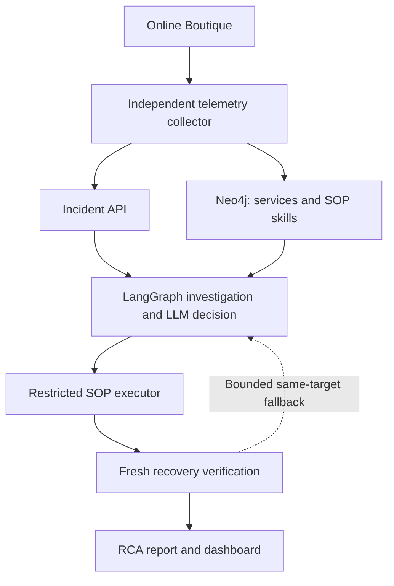

# Agentic GraphRAG for Root Cause Analysis

Topology-aware incident diagnosis and constrained remediation for cloud-native
microservices.

[](https://github.com/raghavnimbalkar1/Agentic-GraphRAG-for-Root-Cause-Analysis-/actions/workflows/tests.yml)

[Architecture](docs/ARCHITECTURE.md) · [Operations](docs/OPERATIONS.md) ·
[Evaluation](docs/EVALUATION_PROTOCOL.md) · [Project Status](docs/STATUS.md)

## Overview

This AIOps research prototype connects independently observed failures to
dependency analysis, graph-vetted remediation procedures, controlled execution
and evidence-backed RCA reports. The testbed is Online Boutique: ten application
services, Redis and a load generator running in Docker Compose.

Neo4j holds two linked graphs: service dependencies describe **where** to
investigate; executable SOP skills describe **how** to respond. LangGraph
coordinates the investigation and recovery loop. The LLM selects and justifies
a procedure from the relevant candidate set; it cannot supply arbitrary scripts
or execution targets.

## Architecture



The workflow provides dependency-chain analysis, potential blast-radius
calculation, exact-name SOP selection, serialized incident handling and
attempt-level audit evidence. Missing, stale or ambiguous health data stops
automatic execution. Recovery requires fresh independent observations, not just
a successful script exit.

Diagnosis uses a hand-authored dependency graph and a deterministic traversal
heuristic, not learned causal discovery. Reachability describes potential impact,
not proof that every dependent service failed. The host-side controller is
trusted and retains Docker authority; container restrictions are not an absolute
host-isolation guarantee.

## Quick Start

**Requirements:** Python 3.11+, Docker with Compose v2, and Neo4j/model credentials
configured in `.env`. The supported deployment runs the Python processes locally.

```bash
bash scripts/setup_dev_env.sh
source .venv/bin/activate
```

The setup script creates `.env` from its template if absent. Configure the Neo4j
password, provider/model/key and active Docker endpoint before starting services.
See [environment configuration](docs/OPERATIONS.md#environment) for details.

```bash
docker compose up -d --wait --wait-timeout 180 neo4j
python -m graph.scripts.init_graph
docker build -t sop-executor:latest sop-executor/
docker compose -f simulation/docker-compose.yml pull
docker compose -f simulation/docker-compose.yml up -d --wait --wait-timeout 300
```

Run each process in a separate terminal from the repository root:

```bash
python -m agent.main
```

```bash
python -m simulation.telemetry_collector --observe-only
```

```bash
streamlit run dashboard/app.py --server.address 127.0.0.1
```

Open the [dashboard](http://localhost:8501) or
[storefront](http://localhost:8080). Observe-only mode records health and incidents
without submitting alerts. **Automatic delivery can incur model charges and
modify simulation containers.** Follow the [operations runbook](docs/OPERATIONS.md)
to enable it and run a controlled incident. Use one API worker and one collector;
keep the unauthenticated API loopback-only.

## Verification

```bash
python -m pytest tests/ -q
python -m ruff check agent core graph simulation dashboard eval scripts tests --select F
python -m eval.research_benchmark --dry-run --max-calls 0
```

The default suite uses no live infrastructure or model requests. Live graph
checks and physical fault experiments are explicit opt-ins. The
[evaluation protocol](docs/EVALUATION_PROTOCOL.md) separates deterministic graph
controls, model-selection experiments and autonomous recovery trials.

### Validation Status

The identified 2026-10-11 record includes 156 passing offline tests, three passing
live Neo4j checks, controlled graph/prompt measurements and four fixed-SOP
physical recovery cases. These measurements made **no LLM requests** and do not
establish autonomous-agent success. Full API/LLM-driven acceptance, comparative
model experiments and submission deliverables remain open.

See [project status](docs/STATUS.md), the
[research evidence matrix](docs/RESEARCH_EVIDENCE_MATRIX.md) and
[raw evidence index](eval/results/verified/20261011/README.md).

## Repository

| Path | Responsibility |
| --- | --- |
| [agent/](agent/README.md) | LangGraph workflow, incident API and restricted execution |
| `core/` | Configuration, contracts, health observations and audit storage |
| [graph/](graph/README.md) | Neo4j catalog, typed queries and initialization |
| [simulation/](simulation/README.md) | Microservices, fault injection and independent collection |
| `sops/`, `sop-executor/` | Curated remediation scripts and executor image |
| [dashboard/](dashboard/README.md) | Live observations, incident reports and evaluation views |
| `eval/` | Scoped fixtures, baselines, ablation and acceptance harnesses |
| `tests/`, `scripts/` | Regression coverage, setup and environment checks |
| [docs/](docs/README.md) | Architecture, operations, research protocol and status |

## Academic Context

MTech final-year project by **Raghav Nimbalkar**, MIT-WPU, Pune.
Guide: **Dr. Bhavana Tiple**.
