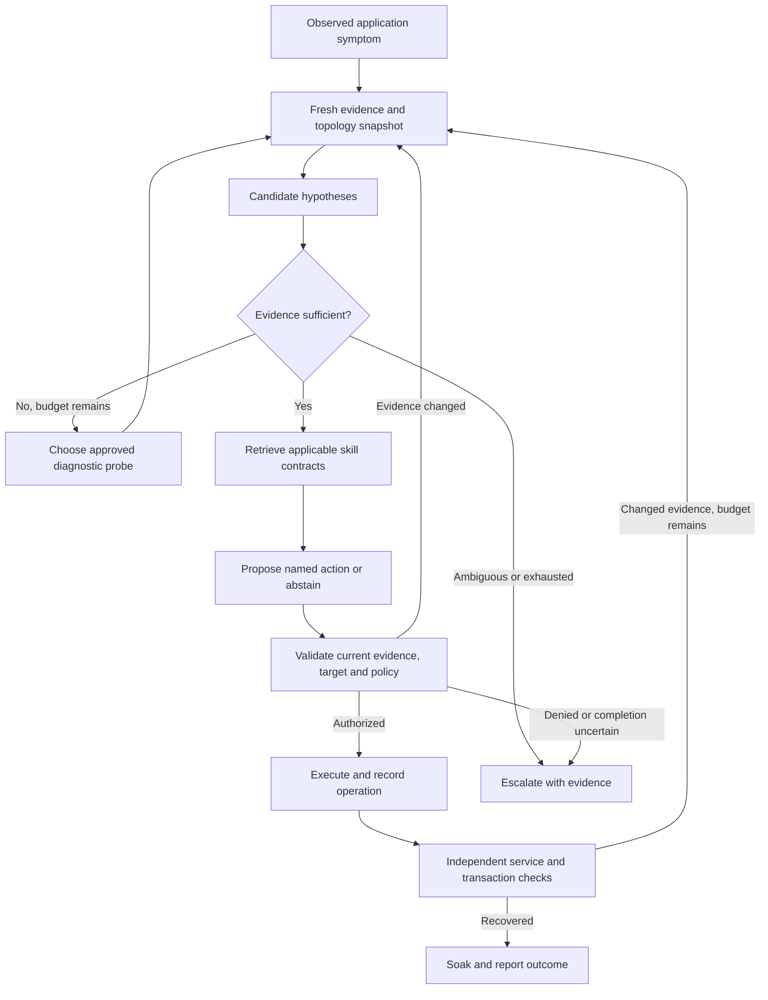

# Implementation Roadmap: Adaptive Investigation and Verified Recovery

Plan date: October 15, 2026. Inspected baseline: `b651586` on `main`.
Status: M0's first reliability slice is integrated into `main` at `725825a`.
Its first reliability slice is implemented: 217 offline tests passed and three
opt-in live graph tests passed separately. The observe-only client-reconnect
rehearsal passed. A repeat ten-minute healthy component soak passed 121/121 samples;
the preceding interrupted run failed and is retained. Actual engine pause/resume
was skipped at the user's request, not passed. See the
[M0 record](../eval/results/verified/20261015/README.md) and
[stability checks](../eval/results/verified/20261016/README.md).
M1's first observation slice is implemented on `codex/symptom-observation`:
versioned registry, bounded evidence store, independent shadow checkout
monitor and read-only dashboard symptom view. See
[scope and operating limits](SYMPTOM_OBSERVATION.md). Full M1
acceptance is pending; M2-M8 have not started.
The first M1 slice has 265 passing offline tests, three separately passing live
graph checks and two real healthy mock checkouts. Its
[record](../eval/results/verified/20261016/m1/README.md) discloses a recorder error
and separate successful final check; no fault or model trial was performed.
The manuscript revision is complete in the existing LaTeX editor. This plan does
not authorize a new model campaign, fault injection or infrastructure purchase.

## Intended Outcome

An observed checkout failure should start an investigation without naming the
injected root. The agent should gather bounded evidence, distinguish payment,
cart/Redis and other plausible causes, select an authorized intervention, check
application recovery, and revise its hypothesis if fresh evidence contradicts
the earlier diagnosis. An unsupported or ambiguous incident should produce a
useful escalation with evidence rather than an invented repair.

The research goal is to determine whether the coupled infrastructure/skill
representation and adaptive model decisions improve outcomes over equally
informed simpler policies. More agents, services or SOP names alone do not answer
that question. The dual graph remains central: infrastructure describes possible
dependencies; skills describe permitted procedures and reviewed transitions.

## Starting Point

| Capability | Implemented baseline | Gap addressed here |
| --- | --- | --- |
| Environment | Online Boutique: ten application services, Redis and load generator | One adapted deployment; fixed service identities |
| Dual graph | 12 services, 15 skills, 16 dependencies, 19 applicability links, one fallback | Curated topology; narrow procedural-transition coverage |
| Observation | Real health, resource and configuration probes; independent alert collector | No general trace/log investigation; automatic alerts favor already-localized roots |
| Decisions | Deterministic Q1 root; real Groq candidate selection | No model-selected diagnostics; mostly single-candidate decisions |
| Execution | Fixed scripts, owned targets, restricted containers, trusted controller | Some injection-specific or temporary operations; no general compensation |
| Verification | Fresh component rounds plus mock checkout when frontend is affected | Short follow-up; no declared durability contract per procedure |
| Reliability | Incident ID ledger and serialized execution | No persistent workflow checkpoint; interrupted incidents require review |
| Evidence | Offline tests, deterministic controls and retained live development trials | No completed frozen, matched comparison establishing LLM or graph benefit |

The [scope assessment](AGENTIC_SCOPE.md), [SOP catalog](SOP_CATALOG.md),
[evidence matrix](RESEARCH_EVIDENCE_MATRIX.md) and
[development records](../eval/results/verified/20261014/README.md) remain the
source of current capability claims. The original planning session ran no live
experiments. Subsequent implementation checks are recorded separately in
[project status](STATUS.md); they do not replace a controlled recovery study.

## Design Decisions

1. Retain Python, FastAPI, LangGraph, Neo4j and the current dashboard. Extend
   existing modules; avoid an unrelated framework or UI rewrite.
2. Keep two logical graphs. Store timestamped observations and incident events
   in an evidence store with IDs referenced by graph/state records. A third
   graph database is not needed to provide provenance.
3. Separate observation, hypotheses, authorization and outcome. A model rationale
   is not an observation, a confidence number is not a calibrated probability,
   and a graph edge is not a causal proof or execution permission.
4. Permit bounded read-only investigation before expanding mutation capability.
   Keep exact named operations and trusted parameter binding for all repairs.
5. Roll out each new decision path through replay, live shadow observation and
   then guarded execution on the disposable testbed. Shadow mode must have no
   access to mutation credentials, even if the model requests an action.
6. Preserve the current baseline and evidence. Version report schemas, catalogs,
   prompts and protocols; never silently rewrite an old incident as successful.

The intended workflow is:

This diagram describes the target behavior. The current workflow does not yet
contain the diagnostic-probe and general replanning loops shown above.

## Milestone Sequence

Estimates are focused engineering days for one developer familiar with this
repository, including tests and documentation. They exclude journal writing,
provider waiting time and hardware procurement. Re-estimate after the first
telemetry pilot; these are planning ranges, not delivery promises.

| Milestone | Main deliverable | Dependency | Effort | Completion evidence |
| --- | --- | --- | ---: | --- |
| M0 | Reliable baseline and versioned evidence contracts | None | 2-3 days | Collector recovers from dependency interruption; stale status is visible; historical reports still load |
| M1 | Symptom observations, telemetry windows and versioned service registry | M0 | 4-6 days | Real failing transactions create symptom incidents; observations retain timestamps and provenance |
| M2 | Bounded diagnostic tools and hypothesis selection | M1 | 4-6 days | Evidence changes the investigation; no free-form tools; deterministic comparison available |
| M3 | Replanning on changed or incomplete recovery | M2 | 3-4 days | Stale candidates are invalidated; loops terminate; original symptom and all attempts remain traceable |
| M4 | Skill contracts, meaningful choices and outcome durability | M1; integrates M3 | 4-6 days | Preconditions enforced; destructive operations gated; temporary mitigation and durable repair distinguished |
| M5 | Persistent workflow and operation reconciliation | M3-M4 | 4-6 days | Restart after an interrupted action cannot blindly repeat it; single-writer recovery verified |
| M6 | Frozen matched experiments and reproducible figures | M0-M5; harness begins earlier | 5-8 days | Complete trial ledger, failures, fair baselines, uncertainty and replayable figure inputs |
| M7 | Second live deployment and measured scale/concurrency | M5; M6 protocol frozen | 8-12 days | Transfer and load measurements on declared hardware, with isolated target ownership |
| M8 | Local-first installable product and public documentation website | Stable M1-M5 interfaces; M6 claims reviewed; M7 transfer evidence | Scope after transfer pilot | Clean-machine install, owned-target onboarding, safe upgrades and documented platform support |

M0-M6 total approximately 26-39 focused days. M7 adds 8-12 days. A useful adaptive
demonstration can be available earlier, after M3/M4, but that is different from a
completed study. The larger deployment is an extension with its own acceptance
criteria; it should not delay the review manuscript's independent revision.

### M0. Baseline Reliability and Evidence Contracts

Implementation areas: `simulation/telemetry_collector.py`,
`simulation/incident_delivery.py`, `core/schemas.py`, `core/audit.py`,
`agent/state.py`, `scripts/check_environment.py`, dashboard status/timeline.

- Move Docker connection/startup failures into a bounded reconnect lifecycle.
  Record unavailable dependency and heartbeat states even when a sample cannot
  be collected. Use one supervised collector, not repeated ad hoc launches.
- Separate process liveness, telemetry freshness and target health. A stale last
  HEALTHY sample must never appear as current recovery evidence.
- Add versioned evidence/event records with incident ID, service/instance ID,
  observation source, source time, collection time, condition interpretation,
  quality and raw-artifact reference. Use UTC event times and monotonic local
  durations; do not compare clocks across machines without recording skew.
- Keep old reports readable. Deprecate the misleading `mttr_seconds` alias in
  presentation; preserve it in historical schemas. Name handling and recovery
  intervals explicitly.
- Freeze the known-working source, dependency constraints, image digests and
  graph/catalog snapshots before new runtime changes. Keep proposed flags off
  by default and retain the current supported path for regression comparison.

Acceptance: test unavailable Docker at startup, pause/resume during collection,
Neo4j interruption, duplicate delivery, stale heartbeat, process restart and
schema-version compatibility. Start with controlled adapters/fakes for failure
paths, then one supervised live lifecycle check. No new fault is required to
verify collector reconnection.

### M1. Observe Symptoms and Retain Diagnostic Evidence

First slice: shared reviewed registry, provenance, bounded numeric evidence,
scheduled mock transactions and persistent frontend symptom episodes are
implemented, including a read-only dashboard view of symptom episodes and their
retained evidence. It does not attribute roots, correlate component anomalies,
ingest traces/logs or drive remediation.
Offline HTTP failure tests do not replace the hidden-fault live acceptance below.

Implementation areas: `core/health.py`, `core/schemas.py`,
`simulation/application_canary.py`, collector/delivery, `graph/graph_client.py`,
`graph/schema_definitions.py`, `simulation/docker-compose.yml`. New modules should
be limited to a service registry, evidence storage and telemetry adapters.

- Replace scattered service-name/port constants with a versioned deployment
  registry. Distinguish environment, logical service and runtime instance.
  Initially populate it from the existing reviewed Boutique configuration and
  owned-container metadata. Discovery must not confer repair permission.
- Run a bounded mock-transaction observer on a schedule independent of fault
  injection. Record the user-facing symptom, transaction step, latency/error
  and observation time. Its small test workload must be identified in results.
- Keep `symptom_service`, candidate roots and attributed root separate. Preserve
  the useful component-health stream, but do not use its pre-localized root as
  the alert origin in the new symptom-driven evaluation path.
- Correlate symptom/component observations into an incident episode without
  creating concurrent repair jobs for every cascaded alert. Correlation is a
  hypothesis with provenance; do not merge unrelated simultaneous faults merely
  because they share a frontend.
- Retain bounded resource windows, sanitized log slices and relevant trace IDs.
  Add an optional OpenTelemetry Collector profile and one trace backend after
  auditing instrumentation in the pinned service images. Do not assume that all
  service versions already emit compatible spans.
- Derive observed caller-to-callee edges from spans, keeping source, first/last
  seen, observation window and topology version. Preserve declared dependencies
  separately from observed calls; missing sampled spans do not prove an edge
  disappeared. The aggregated service graph can contain cycles.

Acceptance: a hidden payment partition causes checkout failure and an incident
whose origin is checkout/frontend, not `paymentservice` supplied by the injector.
An unrelated resource anomaly does not automatically become its cause. Missing
spans, renamed services, stale data and out-of-order samples remain explicit.
All collected details supplied to the model pass sanitization and size limits.

The initial local profile should reuse existing measurements and a bounded
store. Given the 8 GB development machine, measure memory and probe overhead
before enabling additional telemetry containers. Larger profiles belong on
separately provisioned hardware.

### M2. Give the Agent Bounded Investigative Decisions

Implementation areas: `agent/state.py`, `agent/graph.py`,
`agent/nodes/retriever.py`, `agent/nodes/reasoner.py`; introduce a small diagnostic
tool registry and an investigation node rather than a fleet of new agents.

Initial read-only tool set:

| Tool | Input contract | Result |
| --- | --- | --- |
| Dependency snapshot | Registered service ID, topology version, bounded depth | Declared/observed neighborhood and freshness |
| Service readiness | Registered target IDs, fixed probe kind | Timestamped readiness or unknown result |
| Resource window | Target, approved metric, bounded time window | Samples and summary with missing intervals |
| Trace slice | Existing trace ID or bounded incident window | Sanitized relevant spans, call directions and errors |
| Error excerpt | Target, bounded window and fixed filter options | Sanitized excerpts with evidence IDs |
| Configuration comparison | Target and approved field set | Current versus reviewed desired values; no secrets |
| Transaction evidence | Incident and bounded window | Existing canary outcomes; does not initiate a new write operation |

No arbitrary shell, Python, Cypher, SQL, URL or filesystem path may be supplied
by a model through these tools. Implementers control the actual queries. Limit
output size, targets, time window and probe rate as well as total call count.

Use structured decisions: request a permitted probe, propose an evidence-backed
hypothesis, select a retrieved action, or abstain. A hypothesis identifies a
service, possible condition, supporting/contradicting evidence IDs and unresolved
alternatives. Validate the IDs and temporal relevance outside the model.
Do not treat an LLM's declared confidence as permission to mutate a service.

Q1 becomes a candidate generator in this path, retaining its no-model baseline
role. Evidence sufficiency gates are defined by the fault family and procedure
contracts. If those gates cannot distinguish candidates, gather more evidence
or escalate. Start in shadow mode with the mutation boundary inaccessible.

Provisional pilot ceilings: four model decisions, eight diagnostic tool calls,
two state-changing attempts and 180 seconds per incident. These are configurable
test limits, not measured optimal values. Apply an overall token/request budget
including failed calls and retries, and record the reason for every termination.
Do not restart budgets when changing a hypothesis.

Acceptance: matched checkout symptoms caused by payment failure, Redis failure
and an unknown condition lead to different evidence paths or an appropriate
abstention. Invalid tools, prompt injection in logs, fabricated evidence IDs,
repeated probes and provider outages cannot create off-catalog actions. Compare
against a deterministic probe policy given the same tools and initial evidence.

### M3. Replan from Fresh Observations

Implementation areas: retriever, reasoner, executor, evaluator, graph routers and
typed state; extend `tests/test_agent_routing.py` and application recovery tests.

- Introduce an evidence/plan revision. A meaningful condition, identity or
  topology change invalidates the current candidate set and pending action.
- Re-run candidate localization and Q2 when warranted, instead of retaining
  `root_condition` as the permanent diagnosis. Preserve the original symptom
  and prior hypotheses as history.
- Keep immediate preflight validation. A stale proposal is denied; rerouting
  may investigate the new state only after the failed proposal is recorded.
  An uncertain completed operation goes to reconciliation, not another repair.
- A recovered root with a still-failing transaction triggers a bounded new
  investigation, with a new target allowed only after independent authorization.
  A NEXT_IF_FAIL edge alone never permits moving to another service.
- Retain global attempt limits and a target/skill/condition/version attempt key.
  Clearing candidate context must not clear loop prevention or total budgets.

Acceptance cases: HIGH_CPU becomes DEGRADED; payment recovers but checkout still
fails; root recovers before execution; container identity changes; observations
oscillate; no new evidence arrives. The original operation must not execute on
a stale condition. Replay/shadow tests precede guarded live execution under M4.

### M4. Make Procedures Explicit and Outcomes Honest

Implementation areas: `core/schemas.py`, graph catalog/loading, `sops/`,
`agent/tools/control_gateway.py`, `agent/tools/sandbox_tools.py`, executor and
evaluator; update `docs/SOP_CATALOG.md` alongside each behavior change.

Define a versioned skill contract with identity, implementation digest, supported
target capabilities, typed parameters, required evidence/preconditions, affected
resources, operation, risk/disruption, postconditions, repeat policy, expected
durability and optional compensating action. Keep trusted values outside prompts.

Validate definitions at catalog load and before execution. Bind authorization to
the incident/plan revision, skill version, exact target identity and operation.
Catalog edits during an incident invalidate the authorization. Generalizing a
target registry must not remove explicit environment ownership checks.

Develop useful choices based on measured constraints:

- Payment connectivity: an approved reconnect-only operation versus restart and
  reconnect, after distinguishing connectivity from process failure.
- CPU saturation: constrained temporary containment versus restart when process
  state and disruption policy justify it. A quota is not removal of a busy-loop.
- Redis: a reviewed configuration correction or restart when appropriate; data
  deletion only under an explicit disposable-data policy. Do not invent variants
  merely to increase the candidate count.

The Redis flush's current LOW label is insufficient as a data-loss policy.
Represent the consequence explicitly and deny it by default outside the reviewed
disposable environment. Apply the same contract to all mutation paths, including
Redis's currently network-accessible scripts; access to the whole simulation
network is not equivalent to target isolation.

Add rollback only where it is meaningful: for example, restore the captured CPU
quota if the target identity and desired configuration are unchanged. An inverse
command is not always a valid rollback. Restarts and data deletion cannot be
represented as lossless undo. Stop for review when reconciliation is uncertain.

Distinguish repair outcome from cleanup outcome. Record temporary mitigation,
confirmed recovery, recurrence and operator restoration separately. Use a
declared post-repair soak (pilot starting point: 120 seconds) and a longer
campaign check (starting point: 10 minutes) where feasible. Restart durability
tests are procedure-specific and separately labeled; they are not imposed on
every recovery action or counted as autonomous repair.

Acceptance: the same symptom admits different appropriate choices under changed
observations; inappropriate permitted choices are detectable in scoring. Test
contract rejection, catalog drift, data-loss denial, negative side effects,
compensation failure, recurrence and operator cleanup. Judge application outcomes
independently of script exit code.

### M5. Recover Workflow State Without Repeating Unknown Effects

Implementation areas: `agent/graph.py`, `agent/incident_manager.py`,
`core/audit.py`, controller operation records and `agent/main.py`.

- Use LangGraph's supported persistence mechanism with the installed, tested
  dependency version. Start with one worker and a durable local store. A workflow
  checkpoint is not itself a transaction with Docker or Redis.
- Add a persistent operation journal keyed by incident, plan revision, target
  identity, skill version and attempt. Record intent, authorization, start,
  acknowledgement, observed effect and terminal uncertainty.
- On restart, reconcile in-flight effects before resuming decisions. A lost
  response after a restart/flush must not cause automatic repetition. Preserve
  the current conservative stop when evidence cannot establish completion.
- Keep incident claims and fingerprint validation across restarts. Bound queue
  length, model requests, output retention and total incident lifetime.
- Test the single-writer path before adding distributed locks. If multi-worker
  execution is needed for M7, introduce a transactional shared store and leases
  with fencing enforced at the operation boundary, not just an in-memory mutex.

Acceptance: terminate/restart the worker before a call, during execution, after
effect but before acknowledgement, and during verification. Replay may repeat
pure reads but must not blindly repeat uncertain mutations. Test duplicate alert
delivery and stale worker ownership. Make no unconditional exactly-once claim.

### M6. Freeze the Study and Derive Results Step by Step

Implementation areas: `eval/protocol.py`, `eval/research_benchmark.py`,
`eval/live_acceptance.py`, `eval/metrics.py`, `simulation/incident_tracking.py`,
new experiment manifests and plot modules; extend the existing evaluation tests.

Begin event instrumentation with M0; begin replay comparisons with M2. Freeze the
main physical experiment only after M0-M5 acceptance. Use the
[journal study plan](JOURNAL_STUDY_PLAN.md) and
[evaluation protocol](EVALUATION_PROTOCOL.md) for detailed endpoint definitions.

| Comparison ID | Arms and controlled information | Question |
| --- | --- | --- |
| `diagnosis` | Deterministic graph/evidence policy vs model investigation, with the same initial evidence, tools and budgets | Does adaptive investigation help identify supported causes? |
| `selection` | Model versus deterministic ranking over identical approved candidates and evidence | Does the LLM improve action choices? |
| `representation` | Coupled graph versus flat/relational catalog retaining identical dependencies, procedures, applicability and fallback metadata | Does representation/retrieval help independently of information access? |
| `context` | Filtered versus broader candidate context on matched cases with equal relevant knowledge | What is the actual token/decision trade-off? |
| `verification` | Replay/shadow component-only decisions compared with independent transaction evidence | Which false recoveries are prevented and at what latency? |
| `transfer` | Held-out targets, mechanisms, magnitudes and topology changes; then a second deployed system | What transfers and when should the system abstain? |
| `impact` | Predicted structural exposure versus an independently reviewed reference; separate workload-based impact observations | Does potential blast radius predict actual impact? |
| `recovery` | Physical faults, independent detection, matched action policies, application checks and declared follow-up | Does the full loop restore service, and for how long? |
| `safety` | Adversarial model inputs plus direct authorization-boundary tests | Which violations are rejected, and which permitted actions still cause harm? |

Use these stable names in experiment manifests. The two documents use different
RQ numbers; the mapping below prevents accidental changes in meaning.

| Comparison ID | Revised review paper | Existing journal study plan |
| --- | --- | --- |
| `representation` | RQ1: dual-graph contribution | RQ4: coupling with equivalent knowledge |
| `diagnosis` | RQ2: topology and localization | RQ1: supported root attribution; RQ6: adaptive investigation |
| `impact` | RQ3: potential blast radius and observed impact | RQ1's potential-impact measure; separate observed-impact extension |
| `selection` | RQ4: model contribution to procedure choice | RQ3: model versus deterministic policy |
| `context` | RQ4: context size and decision quality | RQ2: context filtering |
| `verification` | RQ5: independently verified service recovery | RQ5: false-recovery prevention |
| `recovery` | RQ5: full physical loop and timing | RQ3's physical policy comparison and the blind-recovery protocol |
| `transfer` | RQ5: transfer beyond a topology fixture; RQ2 negative cases | RQ6: held-out adaptation |
| `safety` | RQ6: model behavior and executor enforcement | Cross-cutting guardrail study, not a separately numbered RQ |

This mapping does not change the meaning of the older journal-plan questions.
Use the comparison ID, manuscript version and RQ together in each figure manifest.

For physical trials, use a separate fault controller and private ground-truth
manifest. Neither its chosen target nor its success indicator belongs in agent
inputs. Sensing and the recovery oracle must observe actual application state.
Include no-fault, unsupported-fault, transient/self-recovery and simultaneous-fault
cases, so every incident is not implicitly guaranteed to have one known repair.

A sensible pilot is 12 declared physical cases across at least three fault
families and negative controls, two policies and three repeated runs: 72 trial
slots. This is a proposed instrumentation pilot, not a powered final sample.
Model calls are not one per trial; estimate cost from the per-incident budget
and measured pilot usage. Freeze the final case count/repetitions from coverage,
variance, precision and available hardware/provider budget. Keep tuning cases
separate from final held-out tests.

Required per-trial chain:

1. Frozen source/catalog/model/prompt, environment, workload, seed and policy.
2. Independently established onset and before/during application behavior.
3. Detection, incident receipt, evidence IDs and graph snapshot used.
4. Diagnostic probes, candidate changes, structured model proposals and validator decisions.
5. Authorized operation, target, times, actual effects and cleanup result.
6. Fresh recovery checks, soak/recurrence, escalation or timeout.
7. Scored endpoints, including failures, provider errors and censored times.

Generate a worked incident timeline, before/during/after recovery trace, recovery
outcomes by fault family, root accuracy/abstention by difficulty, paired policy
differences, time-to-recovery distributions including unresolved cases, token
scaling, and a safety/failure table. Every point must trace to a trial record and
figure manifest. Publish small raw counts alongside percentages and use
scenario-aware uncertainty; repeated runs of one case are not independent cases.

Do not compare our recovery timing with another paper's inference latency.
Prior published scores remain qualitative context unless a faithful comparison
is run on matched tasks and endpoints. If the deterministic policy ties or wins,
report that result and evaluate whether the LLM's diagnostic/reporting utility
justifies its cost instead of manufacturing a superiority claim.

### M7. Transfer, Scale and Concurrent Incidents

Keep the developer profile small. Select a second real application and deploy it
on separately provisioned hardware after measuring its image/telemetry needs.
TrainTicket is a candidate because a topology fixture exists, but that fixture
is not a working deployment. A smaller independently maintained benchmark is a
valid transfer study if resources cannot support TrainTicket.

Introduce a deployment adapter only after the registry/probe/controller contracts
stabilize. A Kubernetes adapter should identify objects by cluster, namespace and
UID, use scoped service accounts and approved operations, and run SOP jobs with
appropriate network and privilege restrictions. Kubernetes is useful here for
studying deployment changes and isolation, not a prerequisite for the initial
adaptive agent.

| Test dimension | Proposed levels | Measurement |
| --- | --- | --- |
| Live deployment size | Current 12; then 25/50/100 deployed services where affordable | Service/instance count, workload, sampling overhead, memory, collector lag and graph freshness |
| Incident load | 1, 2, then 5 simultaneous incidents | Queue delay, throughput, verified recovery, interference and model cost |
| Graph/context stress | Larger generated topologies and SOP catalogs | Query/update latency, recall, memory, prompt size and selection errors |
| Change | Rollout, replica replacement, removed edge, stale evidence, missing telemetry | Correct identity handling, abstention and recovery behavior |

These are proposed levels, not capacities already demonstrated. Graph-only stress
tests must be labeled separately from live application scale. Duplicated instances
must be reported as replicas, not as additional distinct service types.

Begin with serialized repair and parallel bounded reads. Permit concurrent writes
only for declared non-overlapping resource sets with enforced leases/fencing.
Shared databases, network configuration and dependent verification can conflict
even when container names differ. Test contention and stale workers before
claiming concurrent autonomous recovery.

Acceptance: transfer requires only reviewed registry/adapters/procedure bindings,
not root-specific changes to diagnosis logic. Freeze prompts before held-out
tests. Report capacity ceilings, failed runs and bottlenecks; do not advertise
production readiness from a successful 100-node graph query.

### M8. Installable Product and Public Website

The product goal is a system that an operator can install and connect to their
own supported application. It is not an unrestricted repair agent for every
application. This milestone follows the research upgrades; a website and more
install commands do not establish operational scale or diagnostic generality.

Start with a local-first deployment: a Python CLI, the existing local dashboard,
explicit deployment configuration, and approved adapters/procedure bindings.
Keep secrets and operational evidence local by default. A configured external
model still receives sanitized incident context, so onboarding must explain
that data flow and require an explicit provider choice. Local-first does not
mean offline inference.

| Stage | Deliverable | Acceptance gate |
| --- | --- | --- |
| Package | Versioned Python distribution with a CLI; optionally a validated container distribution | Install, start, check and uninstall on clean supported macOS/Linux machines without the repository checkout |
| Connect | Read-only setup checks, service registry import, explicit environment and target ownership | Connecting an application grants no repair permission; unsupported targets remain read-only |
| Operate | Dashboard for evidence, decisions, approval policy, verification and reports | Credentials are excluded from logs; configuration and evidence migrations preserve history; unsafe operations remain blocked |
| Release | Versioned SOP assets, dependency constraints, compatibility matrix, release checks and rollback instructions | Fresh installation and upgrade tests pass; licenses and third-party notices are reviewed; no arbitrary host paths are assumed |
| Explain | Public website with architecture, supported deployments, setup, demo and honest results | Every capability is linked to a released version or labeled planned; claims trace to retained evidence |

Use one primary distribution first. The Python engine makes `pip`/`pipx` a
natural starting point. A Homebrew formula can wrap stable releases later. An
`npm` package is useful only if a genuine JavaScript client or integration is
needed; it should not become a second copy of the engine. Package names and
registry availability have not been selected or checked.

The first connector should cover a reviewed Docker Compose deployment. Add a
Kubernetes connector after M7 validates namespace-scoped identity and operations.
Users supply reviewed topology/configuration and procedure bindings; automatic
discovery must never authorize mutations. Include a read-only mode and require
explicit approval before enabling an application's repair policy.

The website is separate from remote operational control. Do not expose the
current unauthenticated alert API or Docker daemon to the internet. A hosted,
multi-user control plane would be a separate project phase requiring identity,
TLS, per-environment authorization, tenant isolation, quotas, audit retention,
secure connector enrollment and a defined incident-response process. Billing
and fleet management are not prerequisites for the research release.

Success means a second operator can connect a supported application using only
published instructions, reproduce a safe observed recovery, and explain what
the system cannot repair. Report installation success separately from measured
diagnosis, recovery and service-count capacity.

## Delivery Strategy and First Implementation Slice

Use small `codex/` branches for each reviewable milestone slice. Preserve `main`
as the working baseline; merge after relevant checks and an explicit evidence
record. Never publish credentials, raw sensitive logs, unpublished manuscripts
or fabricated benchmark outputs. Archive compatibility notes with schema changes.

The first implementation slice is M0, now on `codex/evidence-baseline`.
Its runtime changes are limited to:

1. Collector reconnect/heartbeat handling and freshness display.
2. Backward-compatible evidence and incident-state fields.
3. Tests for unavailable Docker, stale telemetry, duplicate delivery and old reports.
4. A measured healthy baseline and restart/reconnect acceptance record.

Deliver M0 in three small, reviewable changes:

| Slice | Work | Required checks before merge |
| --- | --- | --- |
| M0.1 | Read-only baseline manifest and backward-compatible evidence schema | Existing reports load; missing fields remain unknown, not healthy; no secrets enter artifacts |
| M0.2 | Bounded collector reconnect and heartbeat state | Docker unavailable at startup, pause/resume, Neo4j outage and repeated delivery tests pass without duplicate workers |
| M0.3 | Freshness display and one supervised lifecycle rehearsal | Dashboard distinguishes stale data from unhealthy service; recovery after reconnect is recorded from new samples |

The live M0 rehearsal uses the local simulation only. It must not inject a new
fault, execute a repair or send a model request. Record any required operator
action separately. If the collector cannot recover reliably, keep new adaptive
features disabled and fix that failure before M1.

Before each merge, run the relevant focused tests and the full offline suite.
Use opt-in live checks only where the milestone requires them. Record the source
revision, environment, command scope and outcome. Do not turn a skipped live
test into a passing result. Keep the existing working path available while the
new path remains behind an explicit configuration flag.

Then add the symptom observer and bounded investigation path. Keep the existing
graph-as-allowlist checks active throughout. Update the dashboard as behavior
arrives: show symptom, hypotheses, evidence timestamps, probes, candidates,
revisions, execution and outcome as a live incident timeline. Do not expose
unnecessary implementation detail in the operator's normal workflow.

The publication-focused release requires M0-M6 and a defensible held-out study.
A second live environment materially strengthens transfer claims. The larger
25/50/100-service deployment is a separate scale extension whose scope depends
on measured resources and the research question it can answer.

## Decision Gates

| Gate | Evidence needed | Stop or narrow the scope when |
| --- | --- | --- |
| After M0 | Collector reconnect and freshness checks pass | Stale status can be reported as current health |
| After M1-M2 | A real symptom starts investigation without disclosing the injected root; evidence changes the decision | The agent only repeats a supplied condition-to-SOP mapping |
| Before adaptive mutation | M3 shadow tests and M4 target/precondition checks pass | A changed condition or target identity can reuse an obsolete authorization |
| Before the main study | M5 interruption tests pass; protocol, tuning split, hardware and provider budget are frozen | Unknown operation effects can be repeated, or cases are chosen for successful outcomes |
| Before scale expansion | Local overhead is measured and second-system resources are available | Extra telemetry prevents a reliable baseline or exceeds available resources |
| Before publication claims | Every plotted result maps to a retained trial and a matched comparison | Failed runs disappear, timing endpoints differ, or information access is unequal |

The first formal pilot needs an agreed provider budget and incident count. The
72-slot example above is not permission to run it. If the model adds no useful
benefit, retain that result and simplify the operational path. A strong study can
identify where deterministic policies are sufficient and where investigation helps.

## Completion Checklist

- [x] Review manuscript revised for current evidence, close prior work and clear language.
- [x] Implementation milestones, experiment mappings and first delivery slice defined.
- [ ] M0: reliable observation and evidence contracts.
- [ ] M1: symptom observations and service registry.
- [ ] M2: bounded diagnostic decisions and deterministic control.
- [ ] M3: fresh-evidence replanning in shadow mode.
- [ ] M4: procedure contracts and guarded adaptive remediation.
- [ ] M5: persistent state and uncertain-operation reconciliation.
- [ ] M6: frozen comparison, complete trial ledger and reproducible figures.
- [ ] M7: second live environment and separately measured scale/concurrency.
- [ ] M8: local-first distribution, supported-application onboarding and website.

## Prior Work and Implementation References

- [GALA+](https://arxiv.org/html/2608.08968v1) already studies graph-guided
  investigation. Adding probes alone cannot be the novelty claim; evaluate their
  connection to curated interventions and verified outcomes.
- [From Static to Streaming](https://file.techscience.com/files/onlinefirst/2026/6.15/TSP_CMC_81005/TSP_CMC_81005.pdf)
  already reviews graph construction, drift and operational constraints. Treat
  topology provenance as necessary engineering and a controlled study variable.
- [STRATUS](https://papers.nips.cc/paper_files/paper/2025/file/47a6e9e2c3019f13ad94a0f259fe4970-Paper-Conference.pdf)
  is relevant to mitigation and recoverability. Do not equate our planned limited
  compensation with its formal assumptions or claim all earlier work is advisory.
- [Beyond Fault Localization](https://arxiv.org/html/2608.21310v2) motivates
  examining how evidence supports decisions, beyond whether a final label is correct.
- [LangGraph persistence](https://docs.langchain.com/oss/python/langgraph/persistence)
  supplies supported workflow checkpoint mechanisms; verify compatibility with
  the pinned project environment before integration.
- [OpenTelemetry Collector](https://opentelemetry.io/docs/collector/) provides
  standard telemetry ingestion components. Audit actual service instrumentation
  and resource use rather than assuming universal trace coverage.

These references inform design choices. They do not establish novelty, benchmark
parity or measured superiority for the proposed implementation.
