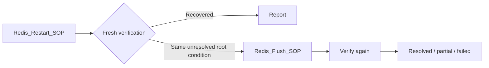

# Remediation SOP Catalog

The executable catalog contains **15 named skills backed by eight maintained
scripts**. Names encode applicability, not fifteen independent implementations.
The authoritative definitions are in
[service_topology.cypher](../graph/cypher/service_topology.cypher); actual Docker
operations are in [control_gateway.py](../agent/tools/control_gateway.py).

The model selects a name from the retrieved candidates. It cannot supply a
script, a shell command, a target container or arbitrary operation parameters.
Catalog risk levels below describe the current disposable testbed policy, not a
production safety assessment.

## What Each Skill Does

| Skill | Target and trigger | Actual operation | Important limitation |
| --- | --- | --- | --- |
| `Redis_Flush_SOP` | `redis-cart`: `STALE_DATA`; also explicit Redis restart fallback | `FLUSHALL ASYNC`, set runtime `maxmemory` to 256 MiB, set policy to `allkeys-lru` | Deletes **all Redis databases' keys**, including carts; current LOW label must not be treated as production permission. Does not repair persistent launch arguments. |
| `Redis_Restart_SOP` | `redis-cart`: `OOM_KILLED` | Restart Redis through the trusted controller; unpause/reconnect if needed | Detector observes a low memory cap, not necessarily a kernel OOM kill. Persistent launch configuration survives restart. |
| `Cart_Restart_SOP` | `cartservice`: `CONNECTION_REFUSED` | Restart the approved container and reconnect it to the simulation network if disconnected | Not a general repair for application-code errors or a missing container. |
| `Payment_Restart_SOP` | `paymentservice`: `CONNECTION_REFUSED` | Same restart/reconnect operation on payment only | Network-partition recovery was demonstrated. Does not establish recovery for every payment failure or real financial transactions. |
| `ProductCatalog_Restart_SOP` | `productcatalogservice`: `CRASH_LOOPING` | Unpause if paused, restart, reconnect if necessary | The condition also labels stopped/paused/missing containers. A missing container cannot be recreated by this SOP. |
| `Checkout_Restart_SOP` | `checkoutservice`: `DEGRADED` | Restart checkout | May clear transient process state; cannot fix an unhealthy dependency or bad image by itself. |
| `Frontend_Restart_SOP` | `frontend`: `DEGRADED` | Restart frontend | A ready process or HTTP homepage is insufficient; cart/checkout must also pass. |
| `AdService_CPU_Throttle_SOP` | `adservice`: `HIGH_CPU` | Set CPU period to 100,000 microseconds and quota to 50,000, equivalent to 0.5 CPU | **Containment, not removal of the busy-loop.** Readiness must still pass. The earlier 0.1-CPU policy caused degradation. |
| `Generic_Restart_SOP` | `currencyservice`, `emailservice`, `shippingservice`, `recommendationservice`, `frontend`: `CRASH_LOOPING` | Restart only the applicable, owned target | "Generic" is not permission to restart every service. In particular, payment has no `CRASH_LOOPING` skill in this catalog. |
| `Disk_Cleanup_SOP` | `emailservice`: `DISK_PRESSURE` | Remove exactly `/tmp/diskfill.bin` inside emailservice | Deliberately tailored to the injected file. It is not a general disk-usage investigator or log-rotation policy. |
| `Memory_Restart_SOP` | `recommendationservice`: `MEMORY_LEAK` | Restart recommendationservice | Reclaims injected/process memory; does not identify or patch a memory leak in source code. |
| `Redis_Pool_Reset_SOP` | `redis-cart`: `POOL_EXHAUSTION` | `CLIENT KILL TYPE normal`; check client count is at most 50 | Disconnects legitimate normal clients too. The detector measures high client count, not a proven exhausted application connection pool. |
| `Redis_Config_Reset_SOP` | `redis-cart`: `CONFIG_DRIFT` | Restore runtime `maxmemory-policy` to `allkeys-lru` and read it back | Covers this one known policy, not arbitrary configuration drift. |
| `Frontend_Latency_SOP` | `frontend`: `DEPENDENCY_TIMEOUT` | Remove the CPU quota (`cpu_quota=-1`) | Repairs CPU starvation used in the testbed; cannot generally cure downstream network latency or an overloaded database. |
| `AdService_Restart_SOP` | `adservice`: `HIGH_CPU` | Restart adservice, terminating the injected process | Drops in-flight work. A restart does not undo an already-applied Docker CPU quota. |

Redis flush, pool reset and config reset are labeled LOW in the catalog; the
remaining skills are MEDIUM. HIGH-risk automatic execution is rejected. These
labels need a deployment-specific approval policy before use with valuable data.

## Execution And Verification

1. Require a complete, recent health snapshot and an unambiguous graph root.
2. Retrieve exact target/condition matches through `APPLIES_TO`.
3. Validate the model's choice against those candidates. `skip`, `escalate`, an
   unavailable provider or an invalid choice does not authorize a repair.
4. Re-probe the root before execution. Changed or unknown conditions stop the
   attempt; a stale diagnosis is not permission to act.
5. Run the curated script in a restricted container. Three Redis scripts use
   simulation-network access; five wrappers request fixed controller operations.
6. Require two healthy verification rounds. When frontend is affected, require
   two successful private-session cart/checkout transactions as well.
7. Preserve the execution, measurements and decision in the incident report.
   A zero exit code alone is never the recovery criterion.

## Fallback Is Explicit

There is **one `NEXT_IF_FAIL` edge**: Redis restart to flush. Other remaining
applicable candidates can be considered through Q2 after an attempt; this is
not a dynamically generated plan. Repeated skills, unsafe targets, changed
conditions and uncertain controller operations remain blocked.

## Extending Coverage

Adding a graph node alone is insufficient. A new procedure needs a reviewed
script, target/operation authorization, measured preconditions, a recovery check,
side-effect analysis, reset or rollback policy, and negative tests. Its detector
must recognize the real symptom independently of the injector. Document whether
the procedure restores service temporarily or removes the underlying cause.

See [agent autonomy and its limits](AGENTIC_SCOPE.md) and the
[publication study plan](JOURNAL_STUDY_PLAN.md).
